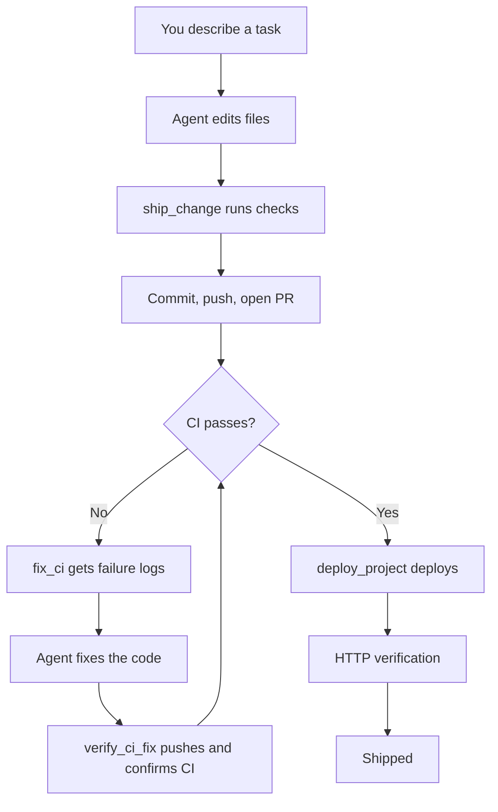

# Causly Server

**The open-source MCP server that turns any AI agent into your technical co-founder.**

<p>
  <a href="https://www.npmjs.com/package/causly-server"></a>
  <a href="./LICENSE"></a>
  <a href="https://github.com/KNIHAL/causly-server/actions/workflows/ci.yml"></a>
  
  <a href="./CONTRIBUTING.md"></a>
</p>

Most agents can write text. Causly Server gives them hands: they ship code, hunt for clients, track deals, take meeting notes, handle your calendar and remind you on Telegram, all from one conversation, all on your own machine.

```bash
npm install -g causly-server
causly-server init
```

<p align="center">
  
</p>

## Contents

- [Why Causly Server](#why-causly-server)
- [Quick start](#quick-start)
- [What you can ask](#what-you-can-ask)
- [How it works](#how-it-works)
- [Tool packs](#tool-packs)
- [Workflow tools](#workflow-tools)
- [Configuration](#configuration)
- [Google setup](#google-setup-gmail-calendar-search-console)
- [Works with](#works-with)
- [Security and privacy](#security-and-privacy)
- [Command reference](#command-reference)
- [Troubleshooting](#troubleshooting)
- [FAQ](#faq)
- [Compatibility](#compatibility)
- [Contributing, roadmap, license](#contributing-roadmap-license)

## Why Causly Server

A founder's week is not only code. It is also finding clients, following up, remembering what was promised in a call, and shipping without breaking things. Causly Server puts all of that behind one MCP server.

- **One server for build, sell, operate and grow.** Git, GitHub, CI and deploys, but also leads, a sales pipeline, meeting notes, calendar, reminders and SEO.
- **Memory that survives the chat.** Your pipeline, meetings and reminders live in a local SQLite file, so the agent can pick up tomorrow where it stopped today.
- **Local-first.** Keys and data stay on your machine. There is no Causly cloud in the loop.
- **Safe by default.** Risky actions need explicit confirmation, file access can be limited to one folder, and secrets are redacted from logs.
- **Light on your agent's context.** Tools load in packs on demand instead of flooding the agent with hundreds of definitions.
- **One command setup.** `init` finds Claude Desktop, Cursor and Windsurf and wires them up.

## Quick start

Requires Node.js 20 or newer.

**1. Install**

```bash
npm install -g causly-server
```

**2. Connect your editors**

```bash
causly-server init
```

`init` adds Causly Server to Claude Desktop, Cursor and Windsurf, whichever you have. It also prints the one-line command for Claude Code. Restart the editor afterwards.

**3. Check everything**

```bash
causly-server doctor
```

**4. Add keys for the services you use (optional)**

```bash
causly-server setup
```

Files, git, shell, Docker and Terraform work with no keys at all. Add keys only for the services you want. Each key is checked live as you enter it.

Useful `init` options:

```bash
causly-server init --client cursor                    # pick editors instead of auto-detecting
causly-server init --workspace D:\my-project          # limit file tools to one folder
causly-server init --toolsets research,pipeline,meetings   # choose which packs load at startup
```

## What you can ask

- "Find companies hiring React developers and add the best three to my pipeline."
- "Save notes from my call with Acme: they want a demo next week, follow up on Friday."
- "What is due this week? Include meeting action items and reminders."
- "Prep me for my next meeting." (needs Google Calendar)
- "Transcribe this recording and list the action items." (needs a Groq key)
- "Ship this change: run the checks, open a pull request, tell me when CI is green."
- "Audit this page for SEO and suggest keywords."
- "Find a free slot on Thursday and create the event."

## How it works

<p align="center">
  
</p>

Your agent talks to Causly Server over MCP (stdio). Inside the server:

1. **Tool router.** `search_tools`, `load_toolset` and `use_tool` let the agent find a tool and call it by name. Packs load on demand, and `use_tool` works even in editors that do not refresh their tool list mid-chat, so you do not need to restart.
2. **Safety layer.** Permission levels, confirmation for risky actions, an optional workspace limit, secret redaction and an activity log.
3. **Tool packs.** About 230 tools grouped into packs (below).
4. **Local store.** SQLite for pipeline, meetings and reminders in `~/.causly`, encrypted secrets, and your API keys in `~/.causly/.env`.
5. **Your services.** GitHub, Vercel, Docker, Terraform, Postgres, Slack, Notion, Linear, Gmail, Google Calendar, Telegram and more, reached with your own keys.

## Tool packs

These packs load at startup by default:

| Pack | Tools | What it does |
| --- | --- | --- |
| files | 9 | Read, write, edit, copy, move and inspect files |
| directory | 5 | List, create and delete directories; search file names |
| command | 1 | Run shell commands with safety checks |
| project | 7 | Detect project type and health; run build, tests, lint and typecheck |
| research | 2 | Search the web and read pages as clean text |
| leads | 3 | Find companies hiring (Hacker News, remote job boards) and public company contact details |
| pipeline | 9 | Local sales pipeline: leads, deals, contacts, activity log, report, CSV export |
| meetings | 9 | Transcribe recordings, save summaries, track action items, link to deals and calendar, prep for calls |
| reminders | 3 | Follow-ups saved locally; ask what is due |

These load on demand, or you can add them to startup with `causly-server toolsets add <name>`:

| Pack | Tools | What it does |
| --- | --- | --- |
| calendar | 8 | Google Calendar: events, free/busy, find meeting slots, create, update, delete |
| gmail | 8 | Search, read, send, reply and forward |
| telegram | 5 | Alert yourself, read messages sent to your bot |
| seo | 4 | Keyword ideas, page audit, draft check, Search Console |
| git | 20 | Status, diff, commit, branch, merge, stash, tags, remotes |
| github | 27 | Repos, issues, pull requests, reviews, Actions |
| workflow | 4 | `ship_change`, `fix_ci`, `verify_ci_fix`, `deploy_project` |
| vercel | 11 | Projects, deployments, HTTP health checks |
| docker | 18 | Build, run, logs, images, exec, Compose |
| terraform | 20 | Init, plan, apply, state, workspaces, PR plan comments |
| database | 8 | Postgres and MySQL queries and schema inspection |
| supabase | 6 | Projects, organizations and SQL |
| slack | 8 | Channels, messages and threads |
| notion | 15 | Pages, databases, blocks and comments |
| linear | 7 | List, read, create, update and comment on issues |
| sentry | 8 | Projects and issues |
| secrets | 6 | Encrypted local secrets store |

Manage startup packs:

```bash
causly-server toolsets                      # show what loads at startup
causly-server toolsets add github,gmail
causly-server toolsets remove seo
causly-server toolsets reset                # back to the defaults
```

## Workflow tools

Single tools are building blocks. These combine them into verified outcomes:

- **`ship_change`**: inspects changes, creates a branch, runs project checks, commits, pushes and opens a pull request.
- **`fix_ci`**: finds a failing GitHub Actions run and fetches the real failure output.
- **`verify_ci_fix`**: commits and pushes the fix, polls the workflow and confirms CI is green.
- **`deploy_project`**: checks health, runs tests and build, deploys, polls, and HTTP-verifies the live URL.



## Configuration

Settings live in `~/.causly/.env` (on Windows, `C:\Users\<you>\.causly\.env`). Manage them with the CLI instead of editing by hand:

```bash
causly-server setup            # step by step, each key checked live
causly-server keys list        # which keys are set (never the full value)
causly-server keys set NAME    # hidden prompt
causly-server keys unset NAME
causly-server doctor --test    # check every configured service live
```

Changes are picked up without restarting your editor.

| Service | Variables | Notes |
| --- | --- | --- |
| GitHub | `GITHUB_TOKEN` | Fine-grained token: contents, issues, pull requests |
| Vercel | `VERCEL_TOKEN` | Project must be Git-linked for deploys |
| Supabase | `SUPABASE_ACCESS_TOKEN` | Management API |
| Slack | `SLACK_BOT_TOKEN` | `search:read` needs a user token |
| Notion | `NOTION_API_KEY` | Share each page or database with the integration |
| Linear | `LINEAR_API_KEY` | Personal API key |
| Sentry | `SENTRY_AUTH_TOKEN` | Add `event:write` to resolve or comment |
| Gmail | `GMAIL_CLIENT_ID`, `GMAIL_CLIENT_SECRET`, `GMAIL_REFRESH_TOKEN` | Run `causly-server login google` |
| Google Calendar | `CALENDAR_REFRESH_TOKEN` | Same Google client as Gmail |
| Telegram | `TELEGRAM_BOT_TOKEN`, `TELEGRAM_CHAT_ID` | Create a bot with @BotFather, message it, then find your chat id with `telegram_get_updates` |
| Groq (meeting transcription) | `GROQ_API_KEY` | Free tier available. Audio is uploaded to Groq only when you confirm a transcription |
| Secrets manager | `SECRETS_MASTER_KEY` | 32-byte hex key you generate and keep |
| Timezone (optional) | `CAUSLY_TIMEZONE` | IANA name, e.g. `Asia/Kolkata`; defaults to your machine's zone |

Docker and Terraform need no key, only the CLI on your `PATH`. Postgres and MySQL take a connection string on each call. Transcribing recordings over 25 MB needs `ffmpeg` on your `PATH`.

## Google setup (Gmail, Calendar, Search Console)

Google needs a one-time OAuth client that you own. It takes about five minutes.

1. Open [Google Cloud Console](https://console.cloud.google.com) and create or pick a project.
2. Enable the APIs you want: **Gmail API**, **Google Calendar API**, and optionally **Google Search Console API**.
3. Open **Google Auth Platform**. Under **Branding**, fill in the app name and your support email. Under **Audience**, choose **External** and add your own Google account as a test user.
4. Under **Clients**, choose **Create client** and pick **Desktop app**. A "Web application" client fails with `redirect_uri_mismatch`. Copy the client ID and secret.
5. Save them in Causly: run `causly-server setup`, or `causly-server keys set GMAIL_CLIENT_ID` and `causly-server keys set GMAIL_CLIENT_SECRET`.
6. Sign in once in your browser:

```bash
causly-server login google            # Gmail and Calendar
causly-server login google all        # also Search Console
```

**Avoid the 7-day expiry.** While your Google app is in *Testing*, Google expires the sign-in token every 7 days. Renew it any time with `causly-server login google`, or stop the expiry for good: in **Google Auth Platform → Audience**, click **Publish app** (In production). The Branding page from step 3 must be filled in first. For personal use you do not need Google verification; at sign-in you will see an "unverified app" warning, which is expected for your own client: choose **Advanced**, then continue.

## Works with

| Client | Setup |
| --- | --- |
| Claude Desktop | `causly-server init` |
| Cursor | `causly-server init` |
| Windsurf | `causly-server init` |
| Claude Code | `init` prints the command: `claude mcp add causly-server -- node <path>/index.js` |
| Any MCP client or agent framework | Spawn `causly-server` over stdio |

Tested with Claude Desktop, Cursor and Windsurf (the same `use_tool` call on a real repository in each), a plain JavaScript MCP client, and LangChain (JS) through `@langchain/mcp-adapters`.

A minimal custom agent in JavaScript:

```js
import { Client } from "@modelcontextprotocol/sdk/client/index.js";
import { StdioClientTransport } from "@modelcontextprotocol/sdk/client/stdio.js";

const client = new Client({ name: "my-agent", version: "1.0.0" });
// Find the install folder with: npm root -g
await client.connect(new StdioClientTransport({
  command: "node",
  args: ["<npm-root>/causly-server/index.js"],
}));

const { tools } = await client.listTools();           // search_tools, load_toolset, use_tool, ...
const result = await client.callTool({
  name: "use_tool",
  arguments: { tool: "git_status", arguments: { repo_path: "." } },
});
console.log(result.content[0].text);
```

## Security and privacy

Causly can touch your files, repositories and infrastructure, so the controls live in the server itself. See [SECURITY.md](./SECURITY.md) to report a vulnerability.

- **Permission levels.** Every tool is `READ`, `LOW`, `MEDIUM`, `HIGH` or `DESTRUCTIVE`. `HIGH` and `DESTRUCTIVE` actions (deploys, merges, shell commands, deletes, raw SQL, Terraform apply and destroy, Docker removal) need an explicit `confirm: true`.
- **Workspace limit.** `causly-server init --workspace <folder>` restricts file and command tools to one folder.
- **Command risk checks.** Drive wipes, formatting and shutdown commands are blocked. Force-pushes, `DROP TABLE`, `curl | bash` and `sudo` are flagged.
- **Path protection.** Writes and deletes inside protected system directories are blocked.
- **Secret redaction.** Tokens, passwords and API keys are redacted before anything is written to logs.
- **Local encrypted secrets.** The built-in secrets manager uses AES-256-GCM with a key you control. No external vault needed.
- **Activity log.** Every call is recorded in `logs/activity.log` as structured JSONL (timestamp, operation ID, risk level, status, redacted input, duration).

**Privacy.** Causly Server has no Causly cloud and no Causly account. Your pipeline, meetings and reminders are stored in a local SQLite file, and your keys stay in `~/.causly/.env`. Data leaves your machine only when you use a service you configured, for example GitHub, Gmail, Telegram, or Groq for transcription, and only to that service.

Optional BoundaryAttest receipts for `ship_change`, `verify_ci_fix` and `deploy_project` are described in [the docs](https://agenv.causly.in/docs/server/tools/boundaryattest).

## Command reference

```text
causly-server                          Start the MCP server (your editor runs this)
causly-server init                     Set up Claude Desktop, Cursor and Windsurf
    --client claude|cursor|windsurf|all
    --workspace <folder>
    --toolsets <list>
    --no-setup
causly-server status                   One screen: editors, keys, pipeline, reminders, backup, updates
causly-server doctor [--test]          Check your setup; --test also checks every key live
causly-server setup [service]          Add API keys step by step
causly-server keys list | set NAME | unset NAME | open
causly-server login google [gmail,calendar,gsc|all]
causly-server toolsets [add|remove|reset]
causly-server backup [file]            Save a copy of your pipeline, meetings and reminders
causly-server restore <file> [--yes]   Put a backup back (current data is kept as a copy)
causly-server remove [--client <name>] Remove it from your editors
causly-server --version
```

## Troubleshooting

Start with `causly-server doctor`. It tells you what is missing.

| Problem | Fix |
| --- | --- |
| `causly-server` is not recognized after install | Open a new terminal so your `PATH` refreshes. Check that your npm global folder (`npm config get prefix`) is on `PATH`. |
| Editor does not show the tools after `init` | Quit the editor completely (including the system tray) and open it again. |
| The agent cannot see a tool that is not loaded | Ask it to call the tool with `use_tool`, or run `causly-server toolsets add <pack>`. |
| Gmail or Calendar stopped working | Your Google token expired (7 days in Testing mode). Run `causly-server login google`. |
| `redirect_uri_mismatch` during Google sign-in | Your OAuth client is a "Web application". Create a **Desktop app** client instead. |
| A reminder never reached Telegram | Set both `TELEGRAM_BOT_TOKEN` and `TELEGRAM_CHAT_ID`, then run `causly-server doctor --test`. |
| Transcription fails on a large file | Install `ffmpeg` and make sure it is on your `PATH`. Files above 25 MB are compressed first. |
| `restore` cannot replace the data file | Quit Claude Desktop, Cursor and any app using Causly Server, then run it again. |
| A file or command is refused | A workspace limit may be on. Check `causly-server doctor`, or re-run `init` with the folder you want. |

## FAQ

**Is it free?** Yes. It is MIT licensed, including for commercial use. The services you connect have their own pricing.

**Does my data go to Causly?** No. There is no Causly cloud in the loop. See [Security and privacy](#security-and-privacy).

**Do I need every key?** No. Add keys only for the services you use.

**Which agents work with it?** Any MCP client. It is tested with Claude Desktop, Cursor, Windsurf, a plain JavaScript client and LangChain (JS).

**Why is my agent not calling a tool?** It may be in a pack that is not loaded. Tell the agent to use `use_tool`, or add the pack with `causly-server toolsets add <pack>`.

**How do I update?** `npm update -g causly-server`. `status` and `doctor` tell you when a new version is out.

**How do I back up my data?** `causly-server backup` saves your pipeline, meetings and reminders to a file. `causly-server restore <file>` puts it back.

**How do I remove it?** `causly-server remove` takes it out of your editors. Then `npm uninstall -g causly-server`.

**Is there a hosted version?** Causly Hosted is in development. [Join the waitlist](https://tally.so/r/NpZkpW).

## Compatibility

| | Status |
| --- | --- |
| Node.js | 20 or newer |
| Windows | Tested |
| macOS and Linux | Expected to work; not yet tested on real machines. Reports welcome. |
| Editors | Claude Desktop, Cursor, Windsurf (tested); Claude Code (command printed by `init`) |

## Known limitations

- `vercel_create_deployment` and `deploy_project` need the Vercel project to be Git-linked already.
- `supabase_run_sql` uses the Supabase Management API; some personal access tokens get a `403` for SQL.
- `slack_search_messages` needs a Slack user token with the `search:read` scope.
- `docker_push` needs registry authentication already configured on the host.
- Sentry `resolve_issue`, `ignore_issue` and `add_comment` need a token with the `event:write` scope.

## Contributing, roadmap, license

- Docs: [agenv.causly.in/docs/server](https://agenv.causly.in/docs/server/intro)
- [CONTRIBUTING.md](./CONTRIBUTING.md) explains how to add a tool pack and the manual testing checklist. Please read the [Code of Conduct](./CODE_OF_CONDUCT.md) too.
- [ROADMAP.md](./ROADMAP.md) has what is planned next. [CHANGELOG.md](./CHANGELOG.md) has release history.
- License: [MIT](./LICENSE).

## Want something custom built on this?

Need a custom MCP server, a specific integration, or a related service for your product or team? Reach out: **nihal@causly.in**

## Causly Hosted

Do not want to run Causly Server yourself? Causly Hosted is a managed version, currently in development.

[Join the Causly Hosted waitlist](https://tally.so/r/NpZkpW)
