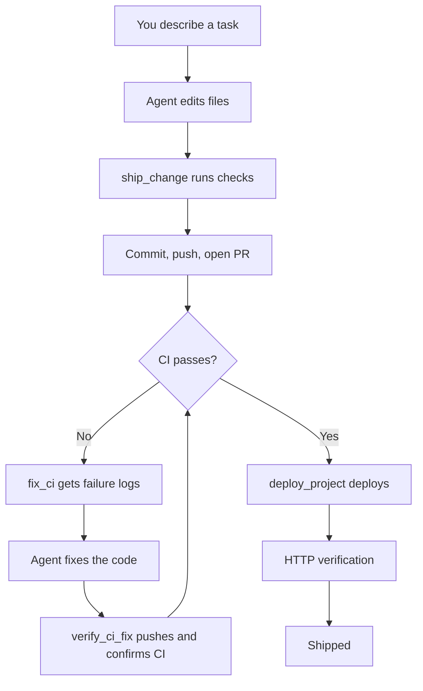

# Causly Server — Turn Any AI Agent Into Your Technical Co-Founder

[](https://www.npmjs.com/package/causly-server)
[](./LICENSE)
[](https://github.com/KNIHAL/causly-server/actions/workflows/ci.yml)
[](./CONTRIBUTING.md)

**An open-source MCP server that gives your AI agent the tools of a co-founder: ship code, find leads, track deals, take meeting notes, handle email and your calendar, all from one conversation.**

Your agent stops being a chatbot that writes text and starts doing the work: it reads your repo, opens the pull request, finds companies that are hiring, logs them in your pipeline, books the follow-up, and reminds you on Telegram.

Everything runs on your machine. Your keys, your data, your approval for anything risky.

## See It In Action

[Working Demo](https://github.com/user-attachments/assets/7f4f33e8-2cd4-4c99-ada0-35653bbaa4c4)


## What You Can Ask

Once it is installed, just talk to your agent:

- "Find companies hiring React developers and add the best three to my pipeline."
- "Save notes from my call with Acme: they want a demo next week, follow up on Friday."
- "What is due this week? Include meeting action items and reminders."
- "Prep me for my next meeting."
- "Ship this change: run the checks, open a pull request, and tell me when CI is green."
- "Audit this page for SEO and suggest keywords."
- "Find a free slot with this lead on Thursday and send the invite."

## Install

Requires Node.js 20 or newer.

```bash
npm install -g causly-server
causly-server init
```

`init` finds Claude Desktop, Cursor and Windsurf on your machine and adds Causly Server to each. Restart your editor and you are done. Using Claude Code instead? `init` prints the one-line command for it.

Useful options:

```bash
causly-server init --client cursor            # pick editors instead of auto-detecting
causly-server init --workspace D:\my-project  # limit file tools to one folder
causly-server init --toolsets research,pipeline,meetings   # choose startup packs
```

### Add your API keys

You only need keys for the services you actually use.

```bash
causly-server setup            # step by step, each key is checked live
causly-server doctor --test    # verify every configured service
causly-server status           # one screen: editors, keys, pipeline, reminders, updates
```

Keys are stored in `~/.causly/.env` (hidden prompt, never printed back) and picked up without a restart.

## Google Setup (Gmail, Calendar, Search Console)

Google needs a one-time OAuth client that you own. It takes about five minutes.

1. Open [Google Cloud Console](https://console.cloud.google.com), create or pick a project.
2. Enable the APIs you want: **Gmail API**, **Google Calendar API**, and optionally **Google Search Console API**.
3. Go to **Google Auth Platform**. Under **Branding**, fill in the app name and your support email. Under **Audience**, choose **External** and add your own Google account as a test user.
4. Go to **Clients → Create client** and choose **Desktop app** as the application type. (A "Web application" client fails with `redirect_uri_mismatch`.) Copy the client ID and secret.
5. Save them in Causly: `causly-server setup`, or `causly-server keys set GMAIL_CLIENT_ID` and `causly-server keys set GMAIL_CLIENT_SECRET`.
6. Sign in once in your browser:

```bash
causly-server login google            # Gmail and Calendar
causly-server login google all        # also Search Console
```

### Avoid the 7-day token expiry: Publish the app

While the Google app is in **Testing** status, Google expires the sign-in token every 7 days. You can renew it any time with `causly-server login google`.

To stop that for good, go to **Google Auth Platform → Audience** and click **Publish app** (set it to *In production*). This needs the Branding page from step 3 to be filled in first. For personal use you do not need Google verification; at sign-in you will see an "unverified app" warning, which is expected for your own client: choose **Advanced**, then continue.

## Tool Packs

Tools are grouped in packs and loaded lazily, so your agent is never flooded with hundreds of tool definitions. The packs below load at startup:

| Pack | What it does |
| --- | --- |
| **files, directory, command, project** | Read, write, edit and search files; run commands with safety checks; detect your stack and run build, test, lint and typecheck |
| **research** | Search the web and read pages as clean text |
| **leads** | Find companies hiring (Hacker News, remote job boards) and public company contact details |
| **pipeline** | Local sales pipeline: leads, deals, contacts, activity log, report, CSV export |
| **meetings** | Transcribe recordings, save summaries, track action items, link them to deals and calendar events, prep for calls |
| **reminders** | Follow-ups saved locally; ask what is due |
| **seo** | Keyword ideas, page audit, draft check, Search Console |

More packs are one command away and load on demand:

| Pack | What it does |
| --- | --- |
| **calendar, gmail** | Events, free/busy, find meeting slots; search, read, send, reply, forward |
| **telegram** | Alert yourself, read messages sent to your bot |
| **git, github, workflow** | Full Git; repos, issues, pull requests, reviews, Actions; `ship_change`, `fix_ci`, `verify_ci_fix`, `deploy_project` |
| **vercel, docker, terraform** | Deployments and health checks; containers and Compose; plan, apply, state |
| **database, supabase** | Postgres and MySQL queries and schema; Supabase projects and SQL |
| **slack, notion, linear** | Channels and threads; pages and databases; issues |
| **sentry, secrets** | Issue triage; encrypted local secrets store |

That is 230+ tools in total. Choose which packs load at startup:

```bash
causly-server toolsets                 # show what loads at startup
causly-server toolsets add github,gmail
causly-server toolsets remove seo
causly-server toolsets reset
```

### No restart needed: `use_tool`

Some editors do not refresh their tool list mid-chat. `use_tool` lets your agent call any tool by name, even one that is not loaded yet; the pack loads automatically and every safety check still applies.

## Workflow Tools

Single tools are building blocks. These combine them into verified outcomes:

- **`ship_change`**: inspects changes, creates a branch, runs project checks, commits, pushes, opens a pull request.
- **`fix_ci`**: finds a failing GitHub Actions run and fetches the real failure output.
- **`verify_ci_fix`**: commits and pushes the fix, polls the workflow, confirms CI is green.
- **`deploy_project`**: checks health, runs tests and build, deploys, polls, and HTTP-verifies the live URL.



## Works With

Tested with Claude Desktop, Cursor, Windsurf, a plain JavaScript MCP client, and LangChain (JS) through `@langchain/mcp-adapters`. Any MCP-compatible client or agent framework can connect to the same stdio server.

## Security

Causly can touch your files, repositories and infrastructure, so the controls live in the server itself.

- **Permission levels:** every tool is `READ`, `LOW`, `MEDIUM`, `HIGH` or `DESTRUCTIVE`. `HIGH` and `DESTRUCTIVE` actions (deploys, merges, shell commands, deletes, raw SQL, Terraform apply and destroy, Docker removal) need an explicit `confirm: true`.
- **Workspace limit:** `init --workspace <folder>` restricts file and command tools to one folder.
- **Approval for outside actions:** anything that emails real people, such as calendar invites with guests, needs confirmation first.
- **Secret redaction:** tokens, passwords and API keys are redacted before anything is written to logs.
- **Command risk checks:** drive wipes, formatting and shutdown commands are blocked; force-pushes, `DROP TABLE`, `curl | bash` and `sudo` are flagged.
- **Path protection:** writes and deletes inside protected system directories are blocked.
- **Local encrypted secrets:** AES-256-GCM with a key you control, no external vault.
- **Activity log:** every call is recorded in `logs/activity.log` as structured JSONL (timestamp, operation ID, risk, status, redacted input, duration).
- **Your data stays local:** the pipeline, meetings and reminders live in a local SQLite file. `causly-server backup` and `restore` keep it safe.

Optional BoundaryAttest receipts for `ship_change`, `verify_ci_fix` and `deploy_project` are described in [the docs](https://agenv.causly.in/docs/server/tools/boundaryattest).

## Command Reference

```text
causly-server init | status | doctor [--test] | setup [service]
causly-server keys list | set NAME | unset NAME | open
causly-server login google [gmail,calendar,gsc|all]
causly-server toolsets [add|remove|reset]
causly-server backup [file] | restore <file> [--yes]
causly-server remove [--client <name>]
```

## Known Limitations

- `vercel_create_deployment` and `deploy_project` need the Vercel project to be Git-linked already.
- `supabase_run_sql` uses the Supabase Management API; some personal access tokens get a `403` for SQL.
- `slack_search_messages` needs a Slack user token with the `search:read` scope.
- `docker_push` needs registry authentication already configured on the host.
- Sentry `resolve_issue`, `ignore_issue` and `add_comment` need a token with the `event:write` scope.
- On Windows, if `npm install` fails with `'node' is not recognized` in a postinstall script, retry with `npm install --ignore-scripts` ([issue #2](https://github.com/KNIHAL/causly-server/issues/2)).

## Documentation, Roadmap, Contributing

- Detailed docs: [agenv.causly.in/docs/server](https://agenv.causly.in/docs/server/intro)
- [ROADMAP.md](./ROADMAP.md), [CONTRIBUTING.md](./CONTRIBUTING.md), [CODE_OF_CONDUCT.md](./CODE_OF_CONDUCT.md), [CHANGELOG.md](./CHANGELOG.md)

## License

[MIT](./LICENSE): free to use, modify and distribute, including commercially.

## Want Something Custom Built On This?

Need a custom MCP server, a specific integration, or a related service for your product or team? Reach out: **nihal@causly.in**

## Causly Hosted

Do not want to run Causly Server yourself? Causly Hosted is a managed version, currently in development.

[Join the Causly Hosted waitlist](https://tally.so/r/NpZkpW)
